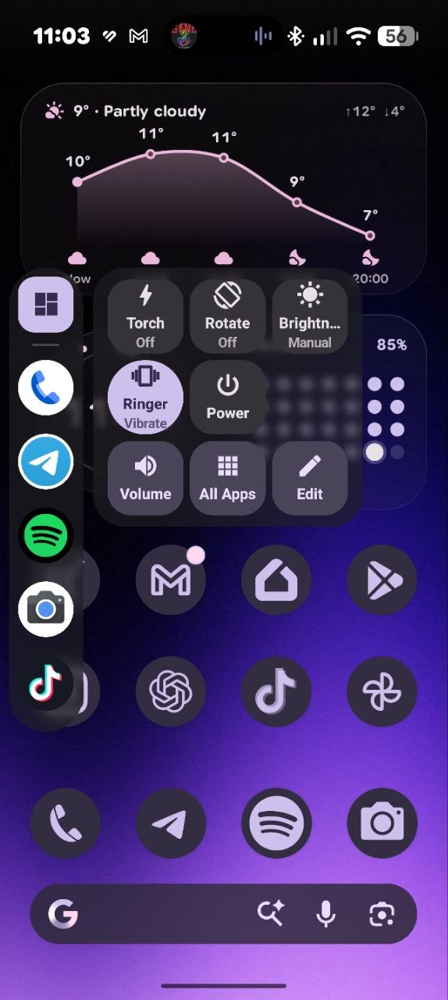
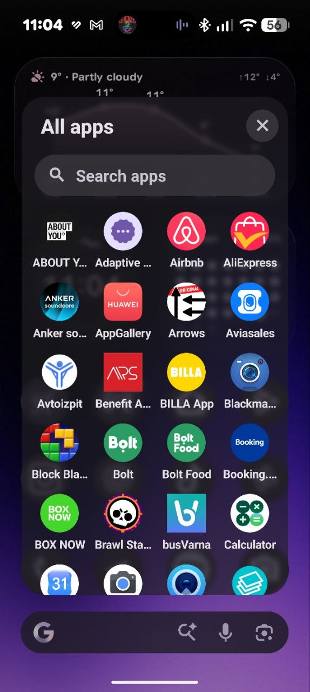
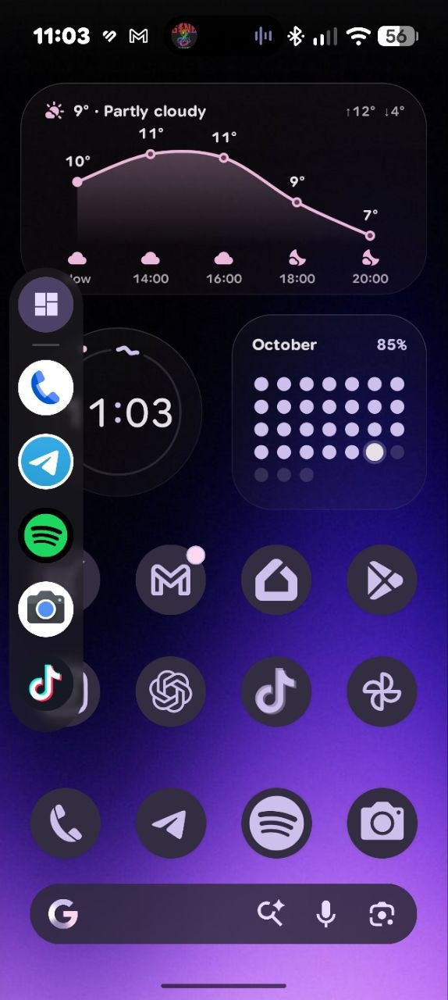

# Sidebar — Material 3 Expressive

> Based on [alkisstam/sidebar](https://github.com/alkisstam/sidebar) by @alkisstam. This version reworks
> the settings app and the overlay in **Material 3 Expressive**: colours from the wallpaper (Material You)
> or your own colour, spring motion, frosted-glass panels (Android 12+ window blur) and a cleaner
> lock-screen behaviour. See [CHANGELOG.md](CHANGELOG.md) — 2.2.0 and 2.2.1.


An Android overlay sidebar for quick access to favorite apps. A pull-tab handle sits on the screen edge and opens a floating panel with quick controls and a grid of your chosen apps.

## Features

- **Pull-tab handle** on the screen edge — left, right, or both sides simultaneously — with configurable vertical position, size (down to 2 dp), and opacity (down to fully transparent)
- **Pill gestures**: swipe in, swipe up, swipe down, and double tap each map to a configurable action — open panel, expand notifications, expand quick settings, or open all apps
- **Slim sidebar panel** (64 dp column): Tools button at top, circular app icons below; tap any app to launch it
- **Tools panel**: opens beside the sidebar with quick-control tiles in a 3-column grid — Torch, Auto-rotate, Auto-brightness, Ringer, Quick Share, Power, QR scanner, Do Not Disturb; drag-to-reorder tiles from settings
- **Brightness and volume sliders** in the tools panel; volume panel with independent Media, Ring, Notification, and Alarm sliders
- **Recent apps**: top rows of the sidebar show the four most recently used apps (cached async for fast panel open); requires Usage Access permission
- **All Apps drawer**: centered overlay with a 4-column alphabetical grid of all installed apps, live search bar, optional auto-keyboard with first-result highlight and Enter-to-launch
- **Long-press context menu** on any app icon with Open option
- **Drag-to-reorder favorites** via long-press on the drag indicator in the open panel
- Persists across reboots via a foreground service and boot receiver
- Auto-hides in fullscreen apps (configurable); battery-friendly polling that pauses when the screen is off
- **Material 3 Expressive** settings UI: spring motion, shape-morphing controls, segmented lists; four tabs (Look, Behavior, Controls, Apps) with swipe navigation
- **System or custom colors**: follows your wallpaper palette (Material You, Android 12+) or a color you pick (presets, color wheel, hex) with Tonal / Vibrant / Expressive / Fidelity styles; the overlay uses the same scheme
- **Background blur** (Android 12+): frosted-glass panel backgrounds, with adjustable strength
- **Look tab**: live preview, theme (auto / light / dark), colors, blur, handle side, position, height, width, opacity
- **Behavior tab**: recent apps, app labels, keyboard on All Apps, freeform windows, auto-hide in fullscreen, vibration, swipe sensitivity, pill gesture mapping
- **Controls tab**: drag-to-reorder active tiles, tap-to-toggle tile grid; permission management for overlay, Do Not Disturb, system settings, and Usage Access

## Gallery





## Installation

Download the latest APK from the [Releases](https://github.com/alkisstam/sidebar/releases) page and sideload it onto your Android device. Enable "Install from unknown sources" in your device settings if prompted.

## Setup

1. Install dependencies
   ```
   npm install
   ```

2. Connect an Android device and run
   ```
   npx expo run:android
   ```

3. In the app, grant the "Display over other apps" permission, then toggle the service on.

4. Optionally grant **Do Not Disturb** and **Modify system settings** permissions (Control tab) to enable the ringer and brightness controls in the panel.

## Development

Start the Metro bundler:
```
npx expo start
```

The debug build connects to Metro over USB or Wi-Fi. For a standalone build:
```
npx expo run:android --variant release
```

## Project structure

```
app/
  _layout.tsx       Root stack navigator
  index.tsx         Main settings screen (4 tabs: Handle, Behavior, Control, Apps)
  favorites.tsx     Legacy app picker (kept for reference)
modules/
  sidebar.ts        React Native bridge to the native Android module
android/
  app/src/main/java/com/alkisstam/sidebar/
    SidebarOverlayService.kt   Foreground service; floating panel and handle
    SidebarModule.kt           React Native native module
    BootReceiver.kt            Auto-start on device boot
```

